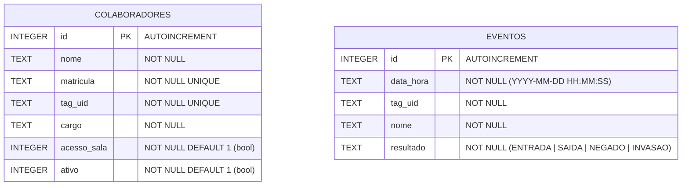
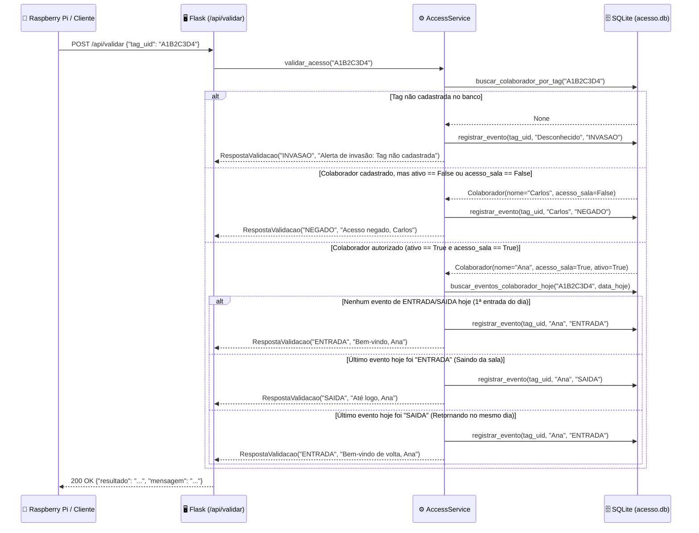

# 🛠️ Tech Spec (Especificação Técnica) — Controle de Acesso e Monitoramento v1

## 1. Visão Geral da Arquitetura

O sistema segue uma arquitetura cliente-servidor desacoplada baseada na especificação RESTful de `api contratos.md`:
- **`server/` (Backend Flask + SQLite):** Expõe a API REST JSON/CSV, aplica todas as regras de negócio de validação de crachá RFID, gerencia a persistência em banco de dados relacional (`sqlite3`) e serve os arquivos estáticos/páginas do Cliente Web.
- **`client/` (Front-end Web Administrativo e Monitoramento):** Interface web rica em HTML5, CSS3 moderno (tema escuro de centro de operações de segurança / estúdio AAA) e JavaScript Vanilla (ES6+ `fetch` API), organizada de forma limpa na pasta `client/`.

### Diagrama de Componentes (Mermaid)

```mermaid
graph TD
    subgraph Client_Dir["🌐 Pasta client/ (Front-end Web)"]
        LoginUI["login.html + app.js (Autenticação)"]
        AdminUI["colaboradores.html (CRUD Colaboradores & Tags)"]
        MonitorUI["monitor.html (Dashboard Segurança - Polling 2s)"]
        Styles["styles.css (UI Dark Mode AAA Studio)"]
    end

    subgraph Server_Dir["🖥️ Pasta server/ (Backend Python 3.12+ / Flask)"]
        AppPy["app.py (Rotas HTTP, Páginas & API REST)"]
        ServicePy["services.py (Regras de Negócio: ENTRADA, SAIDA, NEGADO, INVASAO)"]
        RepoPy["database.py (Repositório SQLite3)"]
        ModelsPy["models.py (Dataclasses & Type Hints)"]
        SQLiteDB[("acesso.db (SQLite)")]
    end

    subgraph External["🔌 Consumidores Externos (Fora do Escopo)"]
        Raspi["🍓 Raspberry Pi (POST /api/validar, GET /api/colaboradores no boot e a cada 3 min)"]
        Pandas["📊 Pandas (GET /api/eventos.csv)"]
    end

    LoginUI -->|POST /login| AppPy
    AdminUI -->|GET, POST, PUT, DELETE /api/colaboradores| AppPy
    MonitorUI -->|GET /api/eventos (a cada 2s)| AppPy
    Raspi -->|HTTP JSON| AppPy
    Pandas -->|HTTP CSV| AppPy

    AppPy --> ServicePy
    ServicePy --> RepoPy
    ServicePy --> ModelsPy
    RepoPy --> SQLiteDB
```

---

## 2. Modelagem de Dados (`dataclasses` & Banco de Dados)

Seguindo as diretrizes de **Python Moderno (3.12+)** do Mestre Jedi, todas as entidades de domínio e objetos de resposta utilizam `@dataclass` e `type hints` estritos em `server/models.py`.

### 2.1 Entidades em Python (`server/models.py`)

```python
from dataclasses import dataclass, asdict
from typing import Literal

ResultadoEvento = Literal["ENTRADA", "SAIDA", "NEGADO", "INVASAO"]

@dataclass(slots=True)
class Colaborador:
    id: int | None
    nome: str
    matricula: str
    tag_uid: str
    cargo: str
    acesso_sala: bool = True
    ativo: bool = True
    na_sala: bool = False
    entrou_hoje: bool = False
    tempo_hoje_segundos: int = 0

    def to_dict(self) -> dict[str, object]:
        return asdict(self)

@dataclass(slots=True)
class Evento:
    id: int | None
    data_hora: str  # Formato: "YYYY-MM-DD HH:MM:SS"
    tag_uid: str
    nome: str
    resultado: ResultadoEvento

    def to_dict(self) -> dict[str, object]:
        return asdict(self)

@dataclass(slots=True)
class RespostaValidacao:
    resultado: ResultadoEvento
    mensagem: str

    def to_dict(self) -> dict[str, str]:
        return asdict(self)
```

### 2.2 Esquema do Banco de Dados SQLite (`server/acesso.db`)



```sql
CREATE TABLE IF NOT EXISTS colaboradores (
    id INTEGER PRIMARY KEY AUTOINCREMENT,
    nome TEXT NOT NULL,
    matricula TEXT NOT NULL UNIQUE,
    tag_uid TEXT NOT NULL UNIQUE,
    cargo TEXT NOT NULL,
    acesso_sala INTEGER NOT NULL DEFAULT 1,
    ativo INTEGER NOT NULL DEFAULT 1
);

CREATE TABLE IF NOT EXISTS eventos (
    id INTEGER PRIMARY KEY AUTOINCREMENT,
    data_hora TEXT NOT NULL,
    tag_uid TEXT NOT NULL,
    nome TEXT NOT NULL,
    resultado TEXT NOT NULL CHECK (resultado IN ('ENTRADA', 'SAIDA', 'NEGADO', 'INVASAO'))
);

CREATE INDEX IF NOT EXISTS idx_eventos_data_hora ON eventos(data_hora DESC);
CREATE INDEX IF NOT EXISTS idx_eventos_tag_uid ON eventos(tag_uid);
```

---

## 3. Fluxos de Sequência e Regras de Negócio

### 3.1 Algoritmo de Validação (`POST /api/validar`)



---

## 4. Especificação Detalhada das Rotas HTTP

### 4.1 Rotas da API (`api contratos.md`)

| Método | Rota | Request Body | Response (`200 OK` / Outros) | Descrição |
| :--- | :--- | :--- | :--- | :--- |
| `POST` | `/login` | `{"usuario": "admin", "senha": "admin"}` | `200`: `{"ok": true, "mensagem": "Login realizado"}`<br>`401`: `{"ok": false, "erro": "Credenciais inválidas"}` | Autentica sessão administrativa (e salva sessão Flask / estado do front). |
| `POST` | `/logout` | — | `200`: `{"ok": true}` | Encerra a sessão do administrador. |
| `GET` | `/api/colaboradores` | — | `200`: `[{"id": 1, "nome": "Ana", "matricula": "01", "tag_uid": "A1B2C3D4", "cargo": "Artist", "acesso_sala": true, "ativo": true, "na_sala": false, "entrou_hoje": true, "tempo_hoje_segundos": 3600}]` | Lista todos os colaboradores com permissões e estado de presença calculado no dia (`na_sala`, `entrou_hoje`, `tempo_hoje_segundos`). Chamada pelo Front-end e pela Raspberry Pi ao ligar e a cada **3 minutos** (`Cache-Control: no-store`). |
| `POST` | `/api/colaboradores` | `{"nome": "Ana", "matricula": "01", "tag_uid": "A1B2C3D4", "cargo": "Artist", "acesso_sala": true, "ativo": true}` | `200`: Objeto do colaborador criado com `id`<br>`400`: Erro de validação / duplicidade de matrícula ou tag | Cadastra novo colaborador. |
| `PUT` | `/api/colaboradores/<int:id>` | `{"nome": "...", "matricula": "...", "tag_uid": "...", "cargo": "...", "acesso_sala": true, "ativo": true}` | `200`: Objeto atualizado<br>`404`: Colaborador não encontrado | Edita dados e permissões do colaborador. |
| `DELETE` | `/api/colaboradores/<int:id>` | — | `200`: `{"ok": true}`<br>`404`: Colaborador não encontrado | Exclui colaborador pelo `id`. |
| `POST` | `/api/validar` | `{"tag_uid": "A1B2C3D4"}` | `200`: `{"resultado": "ENTRADA", "mensagem": "Bem-vindo, Ana"}` | Valida crachá, aplica RN01-RN03 e grava evento no SQLite com horário do servidor. |
| `GET` | `/api/eventos` | — (Opcional `?data=YYYY-MM-DD` ou `?todos=true`, padrão: hoje) | `200`: `[{"id": 1, "data_hora": "2026-10-28 19:15:02", "tag_uid": "A1B2C3D4", "nome": "Ana", "resultado": "ENTRADA"}]` | Retorna eventos do dia (ou filtro solicitado) ordenados do mais recente para o mais antigo. |
| `GET` | `/api/eventos.csv` | — | `200` (`text/csv`):<br>`id,data_hora,tag_uid,nome,resultado` | Exporta todos os eventos do banco em formato CSV. |

### 4.2 Rotas de Páginas Web (Servindo `client/`)
- `GET /` ou `GET /login`: Renderiza a página de login (`client/login.html`).
- `GET /colaboradores`: Renderiza a tela de gestão de colaboradores e tags RFID (`client/colaboradores.html`). Redireciona para `/login` se não autenticado.
- `GET /monitor`: Renderiza a página de monitoramento em tempo real para a segurança privada (`client/monitor.html`). Redireciona para `/login` se não autenticado.

---

## 5. Arquitetura do Cliente Web (`client/`)

Para manter a separação clara entre `server/` e `client/` existente no repositório, o Flask será configurado com `template_folder="../client/templates"` e `static_folder="../client/static"`.

### Funcionalidades da Página de Monitoramento (`client/templates/monitor.html`)
A página faz polling em `GET /api/eventos` a cada **2 segundos** (`setInterval(..., 2000)`) e processa os eventos do dia no próprio cliente (conforme especificado em `api contratos.md`: *"O front monta a tela de logs e a de monitoramento filtrando por `resultado`. 'Dentro da sala' = colaboradores cujo último evento do dia é `ENTRADA`"*):
1. **Painel "Dentro da Sala Agora":** Agrupa os eventos do dia por `tag_uid` (como a lista vem do mais recente para o mais antigo, pega o primeiro evento `ENTRADA` ou `SAIDA` de cada colaborador; se for `ENTRADA`, exibe o colaborador como presente na sala, mostrando também o horário em que entrou e o tempo decorrido).
2. **Painel de Alertas Críticos (Destaque Segurança Privada):** Banner/lista de alta visibilidade filtrando `resultado === "INVASAO"` (vermelho crítico) e `resultado === "NEGADO"` (laranja/amarelo de alerta).
3. **Colunas / Abas de Eventos em Tempo Real:**
   - Últimas Entradas Autorizadas (`ENTRADA`)
   - Últimas Saídas Registradas (`SAIDA`)
   - Tentativas de Acesso Não Autorizado (`NEGADO`)
   - Tentativas de Invasão com Tags Desconhecidas (`INVASAO`)
4. **Simulador Rápido de Leitura (Opcional na UI):** Um botão discreto/modal de "Testar Leitura de Tag" na própria interface web (que dispara `POST /api/validar`) para permitir demonstrar e testar o funcionamento em tempo real mesmo sem a Raspberry Pi conectada!

---

## 6. Estrutura de Diretórios Proposta

```text
raspi-projeto/
├── client/
│   ├── static/
│   │   ├── css/
│   │   │   └── styles.css         # Estilização Dark Mode (Painel Segurança & Admin)
│   │   └── js/
│   │       ├── api.js             # Wrapper fetch() para comunicação com o servidor
│   │       ├── colaboradores.js   # Lógica de CRUD da tela de colaboradores
│   │       └── monitor.js         # Lógica de polling (2s), filtro de salas e alertas
│   └── templates/
│       ├── login.html             # Tela de autenticação
│       ├── colaboradores.html     # Gestão de colaboradores e tags RFID
│       └── monitor.html           # Painel em tempo real da Segurança Privada
├── server/
│   ├── __init__.py
│   ├── app.py                     # Aplicação Flask, rotas de páginas e rotas de API
│   ├── config.py                  # Configurações (caminho do banco, credenciais admin, secret_key)
│   ├── database.py                # Conexão SQLite3, criação de tabelas e queries parametrizadas
│   ├── models.py                  # Dataclasses (Colaborador, Evento, RespostaValidacao)
│   └── services.py                # Regras de negócio isoladas (validação RFID, cálculo de mensagens)
├── tests/
│   └── test_server.py             # Testes automatizados (unittest/pytest) de todas as rotas e regras
├── api contratos.md
└── requirements.txt
```

---

## 7. Estratégia de Tratamento de Erros e Testes

- **Integridade de Dados:** `tag_uid` é normalizado (`strip().upper()`) antes de persistir ou validar, evitando erros por espaços ou diferença de maiúsculas/minúsculas.
- **Erros de Conflito (`400 Bad Request`):** Tentativa de cadastrar dois colaboradores com a mesma `matricula` ou mesmo `tag_uid` retorna mensagem amigável em JSON.
- **Testes Automatizados (`tests/test_server.py`):**
  - Teste de Login (`200` com `admin/admin` e `401` com senha errada).
  - Teste de CRUD completo de colaboradores (`POST`, `GET`, `PUT`, `DELETE`).
  - Teste exaustivo da máquina de estados de `/api/validar`:
    1. Tag desconhecida → `INVASAO`
    2. Colaborador com `acesso_sala=False` → `NEGADO`
    3. Colaborador com `ativo=False` → `NEGADO`
    4. Colaborador autorizado (1ª leitura do dia) → `ENTRADA` (`"Bem-vindo, {nome}"`)
    5. Colaborador autorizado (2ª leitura do dia) → `SAIDA` (`"Até logo, {nome}"`)
    6. Colaborador autorizado (3ª leitura do dia) → `ENTRADA` (`"Bem-vindo de volta, {nome}"`)
  - Teste de exportação `/api/eventos.csv` validando o cabeçalho e linhas geradas.
