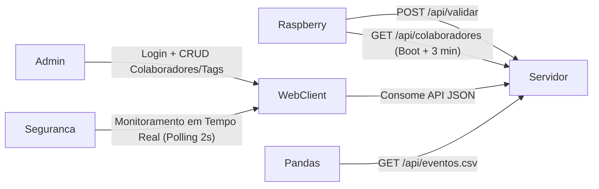

# Sistema de Controle de Acesso e Monitoramento — Sala Restrita AAA

Aplicação conectada (**Servidor Flask + SQLite**) e **Cliente Web** para gerenciamento de colaboradores, tags RFID e monitoramento em tempo real de uma sala restrita, desenvolvida sob a metodologia **Mestre Jedi — Spec-Driven Development**.

---

## Arquitetura do Sistema



---

## Como Executar o Servidor e o Cliente Web

### 1. Ativar o ambiente virtual

Caso ainda não esteja ativo, no PowerShell (Windows):

```powershell
.\.venv\Scripts\Activate.ps1
```

### 2. Iniciar o Servidor Flask

Na raiz do projeto (`raspi-projeto`), execute:

```powershell
.\.venv\Scripts\python.exe -m server.app
```

O servidor iniciará em `http://localhost:5000` (e também escutará na rede local em `0.0.0.0:5000` para que a Raspberry Pi consiga se conectar).

### 3. Acessar o Sistema no Navegador

- **Tela de Login:** `http://localhost:5000/login`
  - **Usuário padrão:** `admin`
  - **Senha padrão:** `admin`
- **Painel de Monitoramento em Tempo Real (Segurança Privada):** `http://localhost:5000/monitor` (atualização via polling a cada **2 segundos** + Simulador Rápido de Leitura RFID integrado).
- **Gerenciamento de Colaboradores e Permissões RFID:** `http://localhost:5000/colaboradores`
- **Exportação CSV (para o Pandas):** `http://localhost:5000/api/eventos.csv`

---

## Como Rodar os Testes Automatizados

```powershell
.\.venv\Scripts\python.exe -m unittest discover -s tests -v
```

---

## Resumo das Rotas da API (`api contratos.md`)

| Origem | Rota | Descrição |
| :--- | :--- | :--- |
| **Raspberry Pi** | `POST /api/validar` | Recebe `{"tag_uid": "..."}`, aplica regras (`ENTRADA`, `SAIDA`, `NEGADO`, `INVASAO`), grava no SQLite e retorna `{"resultado": "...", "mensagem": "..."}`. |
| **Raspberry Pi / Front** | `GET /api/colaboradores` | Lista colaboradores com permissões e estado atual (`na_sala`, `entrou_hoje`, `tempo_hoje_segundos`). Sincronizado pela Pi no boot e a cada **3 minutos**. |
| **Front-end** | `POST /login` | Autentica o administrador (`admin` / `admin`). |
| **Front-end** | `POST /api/colaboradores` | Cadastra novo colaborador e tag RFID. |
| **Front-end** | `PUT / DELETE /api/colaboradores/<id>` | Edita permissões/dados ou exclui colaborador. |
| **Front-end** | `GET /api/eventos` | Eventos do dia (ou `?data=YYYY-MM-DD` / `?todos=true`), mais recentes primeiro (polling 2s). |
| **Pandas** | `GET /api/eventos.csv` | Exporta todos os eventos em formato CSV (`id,data_hora,tag_uid,nome,resultado`). |
